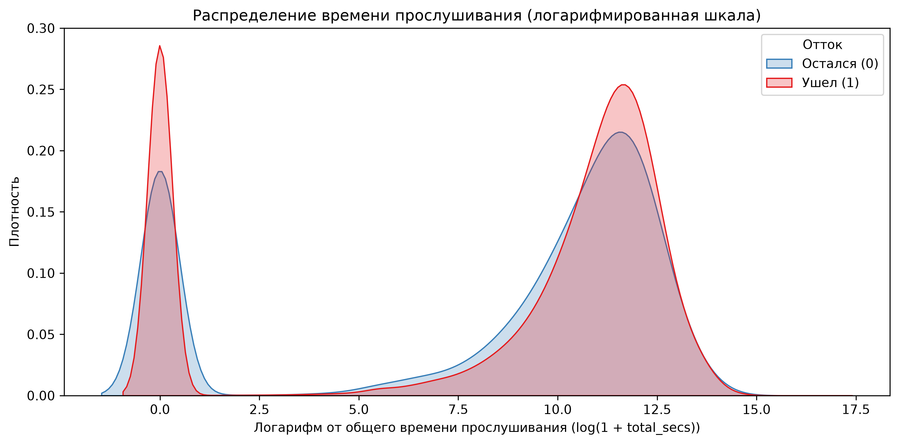
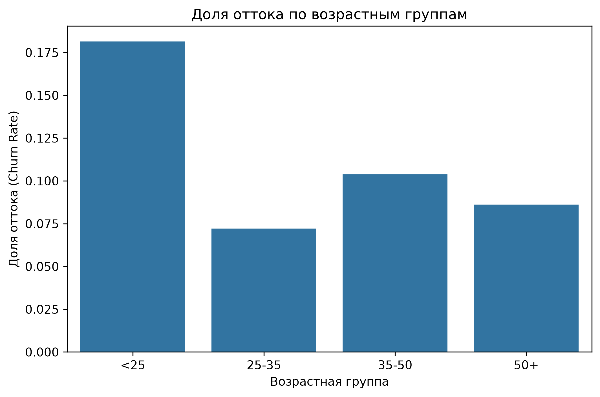

# \# Анализ оттока пользователей стримингового сервиса (KKBox)

# 

# \## 📌 О проекте

# Проект посвящен исследованию причин оттока (churn) пользователей музыкального стримингового сервиса \*\*KKBox\*\* на основе реальных данных (WSDM Cup 2018). 

# Цель исследования — выявить поведенческие и демографические факторы, влияющие на уход клиентов, и сформулировать бизнес-рекомендации по удержанию.

# 

# \## 📊 Данные

# Использован открытый датасет соревнования \[KKBox Churn Prediction Challenge](https://www.kaggle.com/c/kkbox-churn-prediction-challenge). 

# \* \*\*Объем:\*\* \~1 млн уникальных пользователей, 18.3 млн записей о прослушивании.

# \* \*\*Период:\*\* Январь 2015 — Март 2017.

# \* \*\*Исходные таблицы:\*\* Демография (`members`), транзакции (`transactions`), логи прослушивания (`user\_logs`), целевая переменная (`train`).

# 

# \## 🛠 Этапы работы

# 1\. \*\*Data Audit:\*\* Первичный анализ структуры данных, поиск пропусков и выбросов. Выявлен дисбаланс классов (доля оттока — 9%).

# 2\. \*\*Feature Engineering:\*\* Агрегация транзакций и логов на уровне пользователя. Создание признаков (общая сумма платежей, количество уникальных песен, среднее время прослушивания и др.).

# 3\. \*\*Data Preparation:\*\* Обработка пропусков. Для пользователей без активности заполнение нулями (логично, так как они не слушали музыку), для категориальных признаков — выделение в отдельную группу.

# 4\. \*\*EDA \& Statistical Testing:\*\* Визуализация распределений и проверка гипотез с помощью Mann-Whitney U test (для непрерывных метрик) и Chi-square test (для категориальных).

# 

# \## 💡 Ключевые инсайты

# \* \*\*Активность — главный предиктор оттока.\*\* Оставшиеся пользователи в среднем слушают на 30% больше времени (медиана 51 167 сек. против 38 419 сек., \*p-value < 0.001\*). Пользователи с нулевой активностью уходят почти гарантированно.

# \* \*\*Молодежь уходит чаще.\*\* Уровень оттока среди пользователей младше 25 лет составляет \*\*18.1%\*\*, что в 2.5 раза выше, чем в группе 25–35 лет (7.2%). Разница статистически значима (\*p-value < 0.001\*).

# 

# \## 💼 Бизнес-рекомендации

# 1\. \*\*Онбординг в первые дни:\*\* Поскольку нулевая активность ведет к оттоку, нужно мотивировать пользователя слушать музыку в первые 3-7 дней (подборки, бесплатный премиум на неделю).

# 2\. \*\*Специальные предложения для молодежи:\*\* Сегмент до 25 лет требует особого внимания. Возможные меры: студенческие тарифы, геймификация, интеграция с соцсетями для обмена плейлистами.

# 

# \## 📂 Структура репозитория

# \* `data/` — папки для сырых (`raw`) и обработанных (`processed`) данных (игнорируются Git).

# \* `notebooks/` — Jupyter-ноутбуки с этапами анализа (аудит, фичи, статистика).

# \* `reports/` — графики и визуализации.

# \* `requirements.txt` — зависимости проекта.

# 

# \## 🚀 Как запустить

# 1\. Клонируйте репозиторий.

# 2\. Скачайте данные с Kaggle и положите в `data/raw/`.

# 3\. Установите зависимости: `pip install -r requirements.txt`.

# 4\. Запустите ноутбуки в папке `notebooks/` по порядку.

### 1. Активность — главный предиктор оттока

### 2. Молодежь уходит чаще

